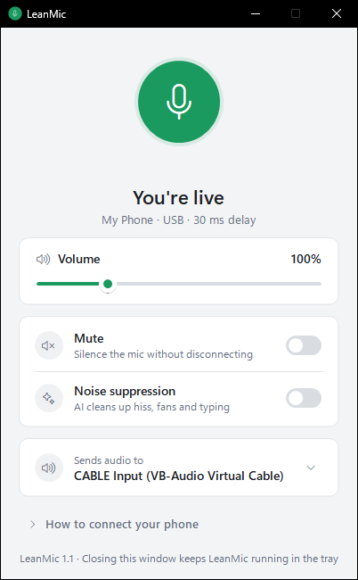
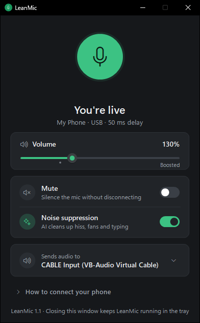
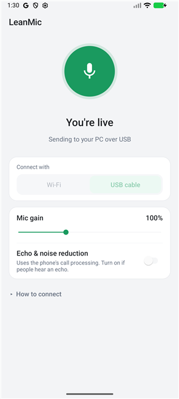
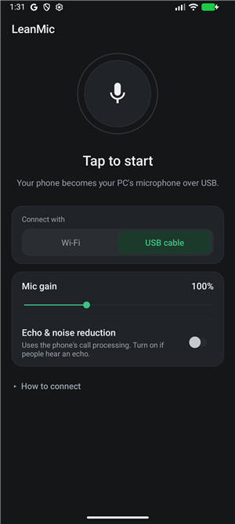

# LeanMic

**Use your Android phone as a wireless or USB microphone for your Windows PC.**
No ads, no accounts, no telemetry, nothing running in the background except what you started.

<p align="center">
  
  
</p>
<p align="center">
  
  
</p>

- 📱 **Phone app:** tiny (about 64 KB), Android 10+. One big button: tap to go live.
- 🖥️ **PC app:** a single `.exe` that lives in the system tray
- ⚡ **Low latency:** about 100–130 ms end to end over USB, and about 120–170 ms over Wi-Fi
- 🔊 **Volume control:** 0–400% boost on the PC, plus 0–300% mic gain on the phone
- 🤫 **AI noise suppression:** uses RNNoise to remove hiss, fans and keyboard noise between your words
- 🌗 **Light and dark:** both apps follow your system theme

LeanMic is a lightweight alternative to phone-as-microphone apps like WO Mic.

---

## Features

| | |
|---|---|
| **USB or Wi-Fi** | USB uses `adb reverse` with no tethering. Wi-Fi finds the PC automatically, so you don't type an IP. |
| **Adaptive buffer** | Starts at about 30 ms (USB) or 50 ms (Wi-Fi). It grows only after a dropout and shrinks only when measurements show it's safe. |
| **Smooth timing** | A ±1% playback-speed nudge holds the buffer steady and absorbs clock drift between phone and PC with no clicks. It never lets lag pile up. |
| **Auto-reconnect** | If the link drops (Wi-Fi blip, PC restart), the phone notices within about 4 s and reconnects on its own. |
| **Screen off** | Keeps streaming with the phone locked, using a foreground service, a wake lock, and a low-latency Wi-Fi lock. |
| **AI noise suppression** | Optional, on the PC. It chains a 90 Hz low-cut filter, [RNNoise](https://github.com/xiph/rnnoise) neural denoising, and a speech-aware gate. It adds about 10 ms. See [Noise suppression](#noise-suppression). |
| **PC controls** | A big mic button that glows with your voice (click it to mute), volume, noise suppression, output-device picker, built-in connection help, and a tray icon that shows the state (idle, live, muted). It works with keyboard and screen readers. |
| **Phone controls** | One big start/stop button with a live level ring, Wi-Fi/USB switch, mic gain, and optional call-style echo and noise reduction. A Stop button also sits in the notification. |
| **One phone at a time** | A second phone gets a clear "another phone is connected" message instead of knocking the first one off. |
| **Plays nice with adb** | Never launches its own adb while another adb server is running, so other tools' USB connections are never interrupted. |

## How it works

```
 Phone (LeanMic app)                         PC (LeanMic.exe)                       Your apps
┌──────────────────────┐   TCP :51235   ┌───────────────────────────┐          ┌──────────────────┐
│ mic → 48 kHz PCM     │ ─────────────► │ adaptive jitter buffer    │          │ Discord / Zoom / │
│ 10 ms chunks         │  Wi-Fi or USB  │ → volume → resample       │ ───────► │ OBS / Teams ...  │
│ gain, noise supp.    │ ◄───────────── │ → "CABLE Input" (VB-Cable)│  "CABLE  │ mic = "CABLE     │
└──────────────────────┘  ack+heartbeat └───────────────────────────┘  Output" │ Output"          │
                                                                               └──────────────────┘
```

Windows only lets drivers create microphone devices, so LeanMic uses the free **VB-Audio Virtual Cable** driver.
LeanMic plays your phone's audio into the cable's input, and the cable shows up in every app as a microphone called **"CABLE Output"**.

## Setup

### 1. Install VB-Audio Virtual Cable (one time)

1. Download **VBCABLE_Driver_Pack** from <https://vb-audio.com/Cable/> and unzip it.
2. Right-click **`VBCABLE_Setup_x64.exe`** → **Run as administrator** → **Install Driver**.
3. Restart your PC.

### 2. Install the apps

Download both from the [**latest release**](https://github.com/thuanquang/leanmic/releases/latest).

- **PC:** run `LeanMic.exe`. It needs the [.NET 9 Desktop Runtime](https://dotnet.microsoft.com/download/dotnet/9.0) (x64).
  When Windows Firewall asks, click **Allow**. Wi-Fi mode needs this. If your network is set to *Public*, tick that box too.
- **Phone:** install `LeanMic.apk`. You may need to allow installing apps from unknown sources.

Prefer to build them yourself? See [Building](#building).

### 3. Check the output

In the PC app, **"Sends audio to"** should say **CABLE Input**. It's picked automatically when VB-Cable is installed.
If VB-Cable is missing, the app shows a banner with a download button.

## Usage

**USB (lowest latency)**
1. On the phone, enable **Developer options → USB debugging** and plug it into the PC.
2. Keep LeanMic open on the PC. It sets up the USB link by itself ("How to connect your phone" shows *Status: ready*).
3. In the phone app, choose **USB cable** and tap the mic.

USB mode needs `adb` (Android platform-tools) on the PC. LeanMic uses an adb server that's already running.
If none is running, it starts one from the Android SDK or from an `adb.exe` placed next to `LeanMic.exe`.

**Wi-Fi**
1. Connect the phone and PC to the same network.
2. In the phone app, choose **Wi-Fi**, leave the PC address empty, and tap the mic. The phone finds the PC automatically.
   If your router blocks discovery, type the PC's IP, shown under "How to connect your phone" in the PC app.

**Then**, in Discord, Zoom, OBS, Teams or Windows sound settings, choose **"CABLE Output"** as the microphone.

When the mic turns green on both screens, you're live. Click the big mic on the PC to mute or unmute.
Closing the PC window keeps LeanMic running in the tray. To quit, right-click the tray icon → **Exit**.

## Latency

| Stage | USB | Wi-Fi |
|---|---|---|
| Phone mic capture | 20–50 ms | 20–50 ms |
| Network | ~1 ms | 3–15 ms (occasional spikes) |
| PC buffer (adaptive) | ~20–40 ms | ~30–60 ms |
| PC output + VB-Cable | ~30–50 ms | ~30–50 ms |
| **Total** | **~100–130 ms** | **~120–170 ms** |

The PC window shows the current buffer size. For the best Wi-Fi results, use 5 GHz and stay near the router.
AI noise suppression adds about 10 ms.

## Noise suppression

There are two independent options. Use one, not both.

**PC: "AI noise suppression"** (recommended). The phone audio passes through three stages:
1. A **90 Hz low-cut filter** removes hum, rumble and desk thumps.
2. **RNNoise**, a small neural network trained to separate speech from noise, cleans each 10 ms frame.
3. A **voice gate** uses RNNoise's speech detection. When you're not talking, leftover noise drops a further 20 dB.
   It opens instantly when you speak and holds for 300 ms, so the starts and ends of words aren't cut off.

Measured on speech mixed with loud noise (noise only about 6 dB quieter than the voice):

| Noise | Removed between words | Voice clarity gain |
|---|---|---|
| Hiss, fans, air conditioning | 26 dB | +8.6 dB |
| Keyboard clicks | 23 dB | +5.7 dB |
| Electrical hum | 6 dB | +7.4 dB |
| Other people talking | — | — (no lightweight denoiser can separate voices) |

**Phone: "Noise suppression / echo cancel"** switches on the phone's own call processing.
Use it mainly if your speakers' sound echoes back into the mic.

If your chat app already has noise suppression (for example Discord's Krisp), you can leave both LeanMic options off.

## Troubleshooting

| Problem | Fix |
|---|---|
| Phone says *"Looking for the PC on Wi-Fi…"* forever | Allow LeanMic in Windows Firewall for your network type (Public or Private), or type the PC IP in the phone app. Some routers block devices from seeing each other ("AP isolation"). |
| Phone says *"Waiting for the PC over USB"* | Check USB debugging is on, the phone has accepted the PC's debugging prompt, and the PC app shows *USB: ready*. |
| PC shows *"USB: needs Android platform-tools"* | Install [platform-tools](https://developer.android.com/tools/releases/platform-tools), or drop `adb.exe` and its DLLs next to `LeanMic.exe`. Wi-Fi works without it. |
| Apps don't list "CABLE Output" | Install VB-Cable and restart the PC (see Setup). |
| Too quiet or too loud | Use the PC volume slider (up to 400%) or the phone's mic gain. The meter turns yellow or red near clipping. |
| Background noise | Turn on **AI noise suppression** in the PC app. |
| Echo in calls | Turn on **Noise suppression / echo cancel** on the phone. |
| Phone says *"Another phone is connected"* | The PC streams from one phone at a time. Stop LeanMic on the other phone. |

Logs and settings are stored in `%APPDATA%\LeanMic`.

## Building

**PC app** (.NET 9 SDK):
```bash
cd pc
dotnet publish -c Release -r win-x64 --self-contained false -p:PublishSingleFile=true -o ../dist
```

**Phone app** (JDK 17 and the Android SDK, API 35):
```bash
cd android
./gradlew assembleRelease   # → app/build/outputs/apk/release/app-release.apk
```
Create `android/local.properties` with `sdk.dir=<path to your Android SDK>` if Gradle can't find the SDK.
The release build is signed with your local debug key, so it can be sideloaded.

## Protocol

Plain TCP on port **51235**, with UDP **51234** for discovery.

- **Discovery:** the phone broadcasts `LEANMIC?` and the PC replies `LEANMIC! <pc-name>`.
- **Stream:** the phone sends `"LMIC"`, `u32 sampleRate`, `u16 channels(=1)`, `u8 nameLen`, `name`, then raw `s16le` PCM. All integers are little-endian.
- **PC → phone:** `K` when the header is accepted, or `B` if another phone is already connected. After `K`, the PC sends 1 byte per second as a heartbeat, and the phone treats 4 s of silence as a dead link.

## Project layout

```
android/   Kotlin phone app (no third-party libraries)
  app/src/main/java/com/leanmic/app/
    MainActivity.kt   screen
    Ui.kt             palette, mic button, segmented control
    MicService.kt     foreground service: capture, discovery, streaming
pc/        C# WinForms tray app (.NET 9, NAudio)
  Audio.cs     adaptive jitter buffer + WASAPI output
  Denoise.cs   low-cut filter + RNNoise + voice gate
  Theme.cs     light/dark palette (follows Windows), fonts, drawing helpers
  Controls.cs  custom-drawn controls (mic orb, toggles, slider, cards)
  Network.cs   TCP server, discovery, adb reverse via the adb socket protocol
  MainForm.cs  UI and tray
```

## License

[MIT](LICENSE). Third-party components (RNNoise, NAudio) are listed in [THIRD_PARTY_NOTICES.md](THIRD_PARTY_NOTICES.md).
